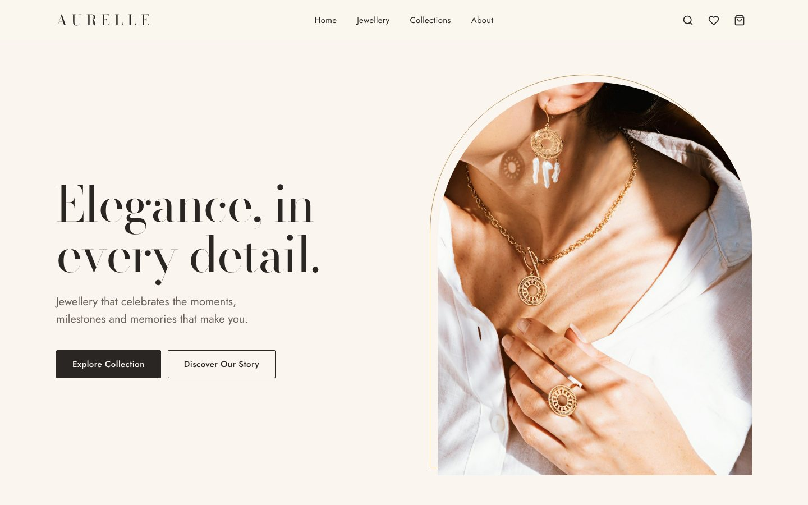
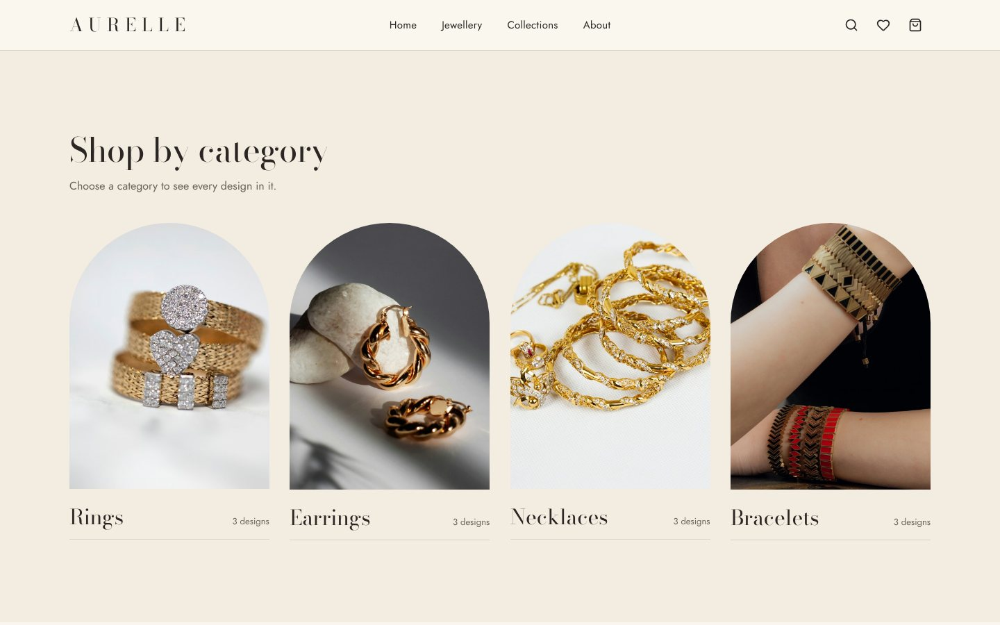
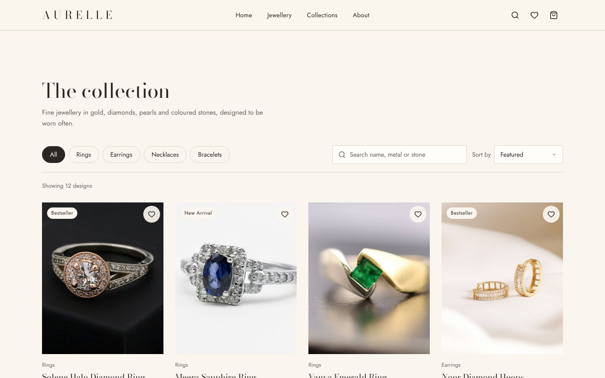
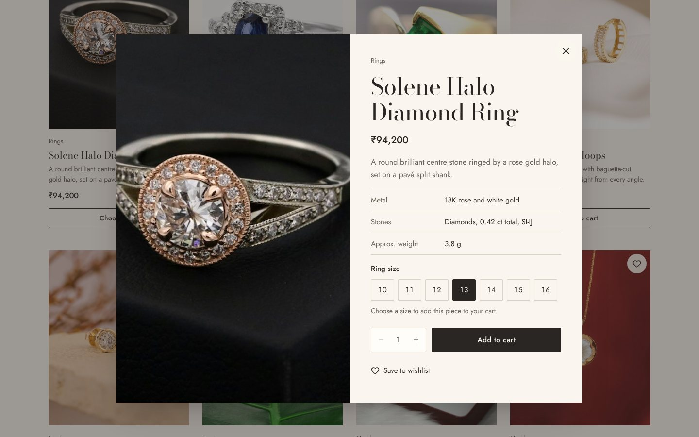
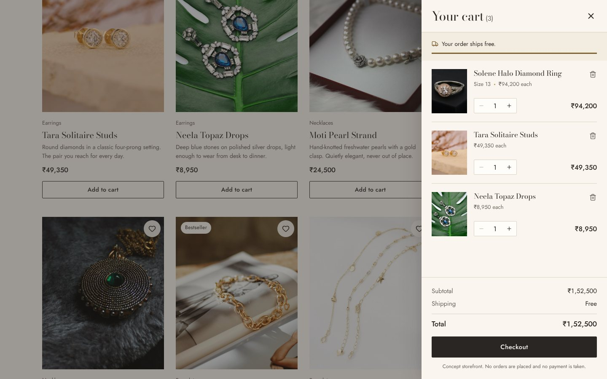
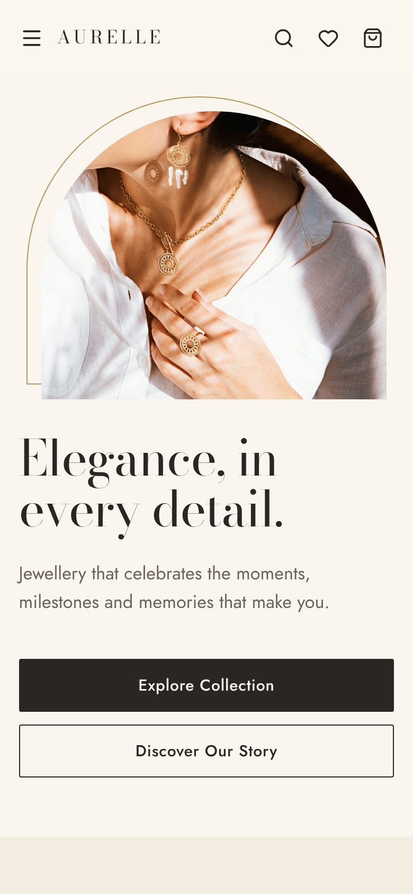
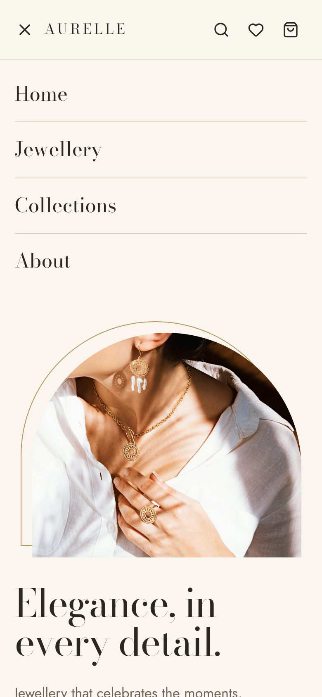

## Live Demo

Explore AURELLE: https://aurelle-jewellery-store-theta.vercel.app/

## Source Code

https://github.com/nithindh2004/aurelle-jewellery-store

# AURELLE — Premium Jewellery Storefront

AURELLE is an independent frontend portfolio project featuring a fictional premium jewellery storefront. The application demonstrates responsive interface design, React component architecture, product discovery, client-side state management, shopping-cart interactions and accessibility-oriented UI development.

> **AURELLE is a fictional concept brand and is not affiliated with BlueStone. All products, prices, brand claims and specifications are illustrative. The application does not process real payments, orders or newsletter subscriptions.**



---

## Contents

1. [Objective](#objective)
2. [Features](#features)
3. [Technology stack](#technology-stack)
4. [Screenshots](#screenshots)
5. [Component architecture](#component-architecture)
6. [Project structure](#project-structure)
7. [Installation on Windows](#installation-on-windows)
8. [Local development commands](#local-development-commands)
9. [Production build](#production-build)
10. [Deployment on Vercel](#deployment-on-vercel)
11. [Testing](#testing)
12. [Image credits](#image-credits)
13. [Pricing assumptions](#pricing-assumptions)
14. [Known limitations](#known-limitations)
15. [AI-assisted development disclosure](#ai-assisted-development-disclosure)

---

## Objective

This project was built as an independent frontend portfolio exercise. Jewellery retail is a demanding frontend domain:
- the products depend on photography and typography;
- shoppers compare high-value items carefully;
- details such as ring sizes, shipping thresholds and prices must behave correctly and consistently.

The aim was to handle those details properly in a small, maintainable React codebase, rather than build a static landing page.

---

## Features

**Product discovery**
- 12 fictional products in four categories (Rings, Earrings, Necklaces, Bracelets), three in each. Prices are in INR with Indian digit grouping (₹2,42,330).
- Category filtering from the category cards or the filter chips. Each card's design count comes from the product data.
- Search across name, category, description, material and specification values, so "emerald", "baguette" or "sterling silver" all work. Every word must match ("rose gold"). The result count is announced to screen readers.
- Sorting: featured, price low to high, price high to low. An empty state explains what didn't match and offers **Clear filters**.

**Quick view**
- Opens from the product photo or name. Shows price, description and a specification table (metal, stones, approximate weight, length or closure).
- Size selection for rings (Indian sizes 10–16) and the bangle set (2.4–2.8 in). Adding a sized piece without a size shows an inline error instead of guessing a default.
- Quantity selector (1–10) and a wishlist toggle.

**Cart**
- Side drawer with unit price, quantity controls, line totals and remove.
- The same ring in two sizes becomes two lines; adding the same item again increases its quantity.
- Subtotal, shipping and total. Shipping is ₹499 below ₹25,000 and free from ₹25,000, with a progress bar.
- **Checkout** shows an inline notice that this is a concept storefront. There is no payment flow.

**Wishlist**
- Heart toggle on every card and in the quick view, plus a wishlist drawer.
- From the drawer, a piece goes straight into the cart, or opens the size selector if it needs a size.

**Persistence and feedback**
- The cart and wishlist are saved to `localStorage` and restored on refresh. Stored data is treated as untrusted and rebuilt on load (see [State](#state-and-persistence)).
- Toast notifications for cart and wishlist changes.
- A newsletter form that validates email format only and says so: *"Email format validated. This is a demonstration form; no subscription has been created."* No address is sent or stored.

---

## Technology stack

| Area | Choice |
| --- | --- |
| UI | React 19: function components, hooks, Context |
| Build | Vite 8 |
| Language | JavaScript (ES modules), HTML5, CSS3 |
| Icons | Lucide React |
| Fonts | Bodoni Moda and Jost, self-hosted via Fontsource |
| Lint | oxlint |
| Unit tests | Node's built-in `node:test` (no extra dependency) |
| Photography | Unsplash, under the Unsplash License |

Runtime dependencies are React, React DOM, Lucide and two font packages. There is no router, state library, CSS framework or backend.

---

## Screenshots

These are captured from the production build. See [`docs/screenshots/README.md`](docs/screenshots/README.md) for how they were made and how to recapture them.

| | |
| --- | --- |
|  |  |
|  |  |

<p>
  
  
</p>

---

## Component architecture

```
App
├── ToastProvider            toast queue + polite live region
│   └── StoreProvider        cart, wishlist, derived totals, which overlay is open
│       ├── Navbar           links, search shortcut, wishlist/cart counts, mobile menu
│       ├── Hero
│       ├── Categories       category cards → set the catalogue filter
│       ├── Catalogue        chips, search, sort → filterProducts() → ProductCard[]
│       ├── Editorial · Benefits · Newsletter · Footer
│       ├── QuickView        ┐
│       ├── CartDrawer       ├─ all built on one accessible <Overlay>
│       └── WishlistDrawer   ┘
```

**Shared building blocks:** `Overlay` (modal and drawers), `SmartImage` (responsive image with fallback and focal crop), `QuantityStepper`, `WishlistButton` and `DrawerHeader`.

**Pure logic in `src/utils/`.** These modules are plain functions with no React, so they are unit-tested directly:
- `filterProducts`: filter, search and sort;
- `cart`: line keys, size rules, stored-data sanitisers;
- `pricing`: the illustrative price calculation;
- `image`: Unsplash URLs and focal crops;
- `format`: INR formatting;
- `focus`: focus placement after a line is removed.

### State and persistence
- **One source of truth.** `StoreContext` owns the cart, the wishlist and which overlay is open; only one overlay is open at a time.
- **Derived, never stored.** Item count, subtotal, shipping, total and free-shipping progress are computed with `useMemo`, so they can't drift out of sync.
- **Robust storage.** `useLocalStorage` survives unavailable storage (private mode, blocked site data). Everything it reads goes through `utils/cart.js`, which:
  - drops unknown products and sizes a product doesn't offer;
  - strips sizes from unsized products;
  - drops invalid quantities, floors fractions and caps at 10;
  - recomputes every line key, and merges duplicate lines.

  `addToCart` applies the same size rule, so an invalid line can't be created at runtime either.

### Accessibility
- **Overlays.** The quick view and both drawers share one `Overlay` component, which:
  - moves focus inside on open and traps Tab and Shift+Tab;
  - closes on Escape or a backdrop click;
  - makes the page behind it `inert` and locks scrolling without a layout jump;
  - returns focus to the control that started the session, even when one overlay replaces another (for example, **Choose size** in the wishlist).

  A custom overlay is used instead of `<dialog>.showModal()`, because the native top layer would cover the toasts that confirm cart actions.
- **Product cards** use a single stretched button. The product name's hit area covers the whole card, giving one tab stop, no clickable `<div>` and no nested controls; the focus ring outlines the whole card.
- **Focus is never dropped:** after removing a cart or wishlist line, or after the newsletter form succeeds.
- **Other details:**
  - skip link and labelled icon buttons;
  - accessible names that start with the visible label;
  - `aria-pressed` toggles and `aria-disabled` quantity limits;
  - errors linked with `aria-describedby`;
  - decorative images hidden from assistive technology;
  - visible focus rings, `prefers-reduced-motion` support, and hover effects only on devices that can hover.
- **Contrast:** text colours meet WCAG AA (4.5:1); the champagne accent is decorative only.

### Responsive design
Fluid type and spacing with `clamp()`, with layout breakpoints at roughly 1100, 900, 760, 520 and 400 px. Tested at 1440, 1366, 1024, 768, 390 and 320 px wide. Overflow is prevented at its source; there is no `overflow-x: hidden` safety net.

---

## Project structure

```
aurelle/
├── index.html
├── package.json · package-lock.json · vite.config.js · .oxlintrc.json
├── public/favicon.svg
├── src/
│   ├── main.jsx · App.jsx
│   ├── components/          one .jsx + .css per component
│   ├── context/             StoreContext.jsx, ToastContext.jsx
│   ├── hooks/               useLocalStorage.js
│   ├── data/                products.js, imageCredits.js, store.js, navigation.js
│   ├── utils/               cart, filterProducts, pricing, image, format, focus
│   └── styles/global.css    design tokens, base styles, buttons, toasts
├── tests/                   cart, filterProducts, pricing, imageAudit (node:test)
├── scripts/                 check-images.mjs, image-audit-lib.mjs
└── docs/
    ├── IMAGE_CREDITS.md
    ├── QA-CHECKLIST.md
    └── screenshots/
```

---

## Installation on Windows

1. Install **Node.js 22 LTS** from [nodejs.org](https://nodejs.org) with the Windows installer, accepting the defaults. Vite 8 needs Node 20.19+ or 22.12+; this is declared in `package.json` → `engines`.
2. Open **Command Prompt** or **PowerShell** and check the install:
   ```powershell
   node -v
   npm -v
   ```
3. Get the code, either by cloning:
   ```powershell
   git clone https://github.com/nithindh2004/aurelle.git
   cd aurelle
   ```
   or by unzipping the project and moving into the folder that contains `package.json`:
   ```powershell
   cd "C:\Users\<your-user>\Downloads\aurelle"
   ```
4. Install the exact dependency versions from the lockfile, then start the site:
   ```powershell
   npm ci
   npm run dev
   ```
5. Open **http://localhost:5173**. Press `Ctrl+C` in the terminal to stop the server.

**If PowerShell says "running scripts is disabled on this system"**, use Command Prompt instead, or allow local scripts for your user:
```powershell
Set-ExecutionPolicy -Scope CurrentUser -ExecutionPolicy RemoteSigned
```

**If port 5173 is busy**, Vite uses the next free port and prints it.

macOS and Linux use the same commands.

---

## Local development commands

| Command | What it does |
| --- | --- |
| `npm run dev` | Development server with hot reload at http://localhost:5173 |
| `npm run lint` | Lints `src/`, `scripts/` and `tests/` with oxlint |
| `npm test` | Runs the unit tests with Node's built-in test runner |
| `npm run check:images` | Checks every photo loads and writes `docs/image-audit.html` (see [Image credits](#image-credits)) |

## Production build

```powershell
npm run build     # optimised build into dist/
npm run preview   # serves dist/ at http://localhost:4173
```

---

## Deployment on Vercel

Vercel detects Vite automatically, so no configuration file is needed.

1. Push the repository to GitHub. `node_modules/` and `dist/` are already excluded by `.gitignore`.
2. Sign in at [vercel.com](https://vercel.com), choose **Add New → Project**, and import the repository.
3. Confirm the detected settings: Framework **Vite**, Build command `npm run build`, Output directory `dist`.
4. Click **Deploy**. Later pushes to the main branch redeploy automatically.

If the build fails with a Node.js version error, set the project's **Node.js Version** to 22.x in its Vercel settings. After deploying, open the live URL in a private window and check the console for errors.

---

## Testing

**Automated, reproducible: `npm test`.** 30 unit tests in `tests/`:
- `cart.test.js`: cart and wishlist sanitisation, covering malformed, outdated and duplicate entries, invalid sizes and quantity limits.
- `filterProducts.test.js`: categories, search by name, material and stone, multi-word search, sorting, INR formatting and catalogue data integrity.
- `pricing.test.js`: the price formula, the bangle worked example, rejection of missing inputs, and consistency of every displayed price and weight.
- `imageAudit.test.js`: the image audit's checks against a local test server, covering success, redirect, HTTP error, non-image response, empty and corrupt bytes, invalid URL, timeout and refused connection.

**Browser QA (development-time, not in this repository).** Navigation, filtering, the quick view, cart, wishlist, persistence, newsletter, keyboard and focus behaviour, console errors and layout were checked in Chromium at 1440, 1366, 1024, 768, 390 and 320 px with a Playwright script during development. That script is not committed, so its results are not presented as a repeatable suite. [`docs/QA-CHECKLIST.md`](docs/QA-CHECKLIST.md) lists the same checks to repeat by hand.

---

## Image credits

All photographs are from [Unsplash](https://unsplash.com), used under the [Unsplash License](https://unsplash.com/license). [`docs/IMAGE_CREDITS.md`](docs/IMAGE_CREDITS.md) lists every photo with its Unsplash page and contributor, and how each was checked:
- not Unsplash+ content;
- the photo matches its product.

No BlueStone assets, branding or copy are used. People shown in the photographs have no connection to AURELLE.

`npm run check:images` re-checks every photo the app uses, at the exact URL and crop the app requests. It reports each result separately:
- loaded;
- HTTP error;
- not an image;
- empty or corrupt data;
- invalid URL;
- network failure (which says nothing about the URL itself);
- duplicate URL or duplicate image content.

It also writes `docs/image-audit.html`, a contact sheet for looking at every photo against its expected subject. A successful load is not a visual check, so the sheet is how you look again. Open the file by double-clicking it in File Explorer.

---

## Pricing assumptions

**Catalogue prices are illustrative and are not retail quotations or live prices.** They are calculated in [`src/utils/pricing.js`](src/utils/pricing.js), so the card, quick view and cart always show the same figure, and the method can be checked.

| Input | Value |
| --- | --- |
| Gold reference rates | 22K ₹13,255/g, 18K ₹10,845/g (24K ₹14,460/g), as published by [GoodReturns for 9 November 2026](https://www.goodreturns.in/news/gold-rates-today-november-9-24k-22k-18k-gold-price-jump-rs-10300-mumbai-delhi-but-falls-in-chennai-1546003.html). These are historical reference values, not live rates. |
| Metal weights | Assumed per product (shown in each product's specifications) |
| Making charges | Assumed, 15–25% of metal value |
| Stone values | Assumed, only for pieces that list stones or inlays |
| GST | 3% of the total transaction value (metal + making + stones), applied once. The GST Council / CBIC sectoral FAQ on gems and jewellery says GST on jewellery is 3% of the total value whether or not making charges are shown separately. |
| Rounding | Nearest ₹10 |

**Formula:** price = (weight × rate + making charge + stone value) × 1.03, rounded to the nearest ₹10.

Worked example (Aarohi bangle set): 14.2 g × ₹13,255 = ₹1,88,221 metal, + 25% making (₹47,055) = ₹2,35,276, × 1.03 = ₹2,42,334.5, displayed as **₹2,42,330**.

| Product | Purity, weight | Metal value | Making charge (assumed) | Stone value (assumed) | 3% GST | Displayed price |
| --- | --- | --- | --- | --- | --- | --- |
| Solene Halo Diamond Ring | 18K, 3.8 g | ₹41,211 | ₹8,242 (20%) | ₹42,000 | ₹2,744 | **₹94,200** |
| Meera Sapphire Ring | 18K, 4.1 g | ₹44,464 | ₹8,893 (20%) | ₹30,000 | ₹2,501 | **₹85,860** |
| Vanya Emerald Ring | 18K, 4.6 g | ₹49,887 | ₹8,980 (18%) | ₹18,000 | ₹2,306 | **₹79,170** |
| Noor Diamond Hoops | 18K, 3.1 g | ₹33,620 | ₹6,724 (20%) | ₹34,000 | ₹2,230 | **₹76,570** |
| Tara Solitaire Studs | 18K, 1.4 g | ₹15,183 | ₹2,733 (18%) | ₹30,000 | ₹1,437 | **₹49,350** |
| Neela Topaz Drops | 925 sterling silver | — | — | — | — | ₹8,950 (assumed catalogue price) |
| Moti Pearl Strand | Freshwater pearls, 18K gold clasp | — | — | — | — | ₹24,500 (assumed catalogue price) |
| Rosa Floral Pendant | 18K, 2.3 g | ₹24,943 | ₹4,490 (18%) | ₹3,000 | ₹973 | **₹33,410** |
| Rani Heritage Pendant | 22K, 11.6 g | ₹1,53,758 | ₹30,752 (20%) | ₹4,000 | ₹5,655 | **₹1,94,160** |
| Lumen Chain Bracelet | 18K, 3.4 g | ₹36,873 | ₹5,531 (15%) | — | ₹1,272 | **₹43,680** |
| Kiara Charm Bracelet Trio | 18K, 4.2 g | ₹45,549 | ₹8,199 (18%) | — | ₹1,612 | **₹55,360** |
| Aarohi Carved Bangle Set | 22K, 14.2 g | ₹1,88,221 | ₹47,055 (25%) | — | ₹7,058 | **₹2,42,330** |

Neela (silver) and Moti (pearls) are not mainly valued by gold weight and the source gives no silver or pearl reference, so they carry plainly assumed catalogue prices instead of an invented calculation. This is not a tax calculator or a billing system.

---

## Known limitations

- **Frontend only.** There is no backend, account, inventory, checkout or payment. The newsletter validates format and discards the address.
- **Illustrative content.** Product names, specifications, prices and brand messaging are fictional. "Transparent Product Details" describes what the product data shows; it is not a certification claim.
- **Static catalogue** in `src/data/products.js`; there is no CMS or API.
- **Single page.** Sections are reached by in-page anchors, and there are no product-detail URLs, so a quick view cannot be shared by link.
- **External photographs** load from Unsplash's CDN. If it is unreachable, styled fallback panels appear instead.
- **Footer.** Social channels and customer-care pages are shown as labelled, non-interactive concept elements.
- **Browser tests** are not in the repository; only the unit tests are automated.

---

## AI-assisted development disclosure

AI tools were used to support ideation, implementation assistance and debugging during development. The final implementation was reviewed and tested as part of the project.

---

AURELLE — Concept Storefront / Portfolio Project.
